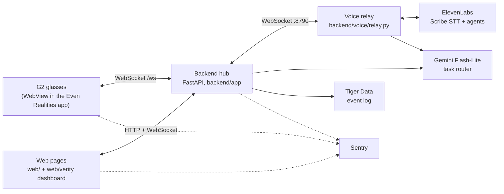

# Floor Sense ("Verity")

Floor Sense puts a restaurant floor on [Even Realities G2](https://www.evenrealities.com/) glasses. Servers see
one task at a time ("RUN · T12 · 2× halibut s1+3") and confirm it with a tap, a voice command ("verity done")
or a head nod; the screen stays blank when nothing needs them. A swipe back turns the last 2 minutes of table
talk into an order by seat, with a summary and menu-checked answers to diners' questions. Managers see only
exceptions plus a floor minimap, and a web dashboard runs the floor.

## Built at LA Hacks (Oct 17-18, 2026)

The repo started empty at the hackathon. The only thing brought in from before is a Claude skill the owner made
beforehand for working with the G2 glasses ([`.agents/skills/g2-glasses-integration/`](.agents/skills/g2-glasses-integration/SKILL.md)).
Everything else (code, fictional menu and floor data, designs) was built during LA Hacks by two humans directing
Devin (Cognition) and Claude Code (Anthropic). Who and what wrote each part is in [AI_USAGE.md](AI_USAGE.md).

- **Glasses HUD** (`glasses/`): three tabs (Controls, Queue, Task), tap / swipe / long press / double tap
  gestures, "verity" voice commands, the 2-minute order clip, ramp mode for new servers, nod to accept
  (HW-PENDING), and a manager view with exceptions and a minimap.
- **Backend hub** (`backend/`): FastAPI + WebSocket hub, task state machine with escalation, run priority for
  plates at the pass, and a Gemini Flash-Lite router that picks the server (rules as fallback).
- **Voice relay** (`backend/voice/`): ElevenLabs Scribe (realtime for commands, batch for clips) and ElevenLabs
  agents for the order and the summary; code checks every dish, alteration and answer against `data/menu.json`.
- **Manager dashboard** (`web/verity/`) plus the Organizer and Kitchen pages (`web/`).
- **Rush simulator** (`sim/`): a two-hour service replayed FIFO vs priority.
- **Observability**: Sentry (backend, pages, glasses) and a Tiger Data (TimescaleDB) event log.

## Architecture



The glasses only talk to the hub; API keys stay on the backend. The message contract is
`glasses/src/contract.ts`, mirrored in `backend/CONTRACT.md`.

## Live server

The team's hosted backend runs on a Vultr server at **https://45-76-173-44.sslip.io** (Caddy with a Let's
Encrypt certificate; how it's built: [backend/deploy/README.md](backend/deploy/README.md)).

- `https://45-76-173-44.sslip.io/health` is public: `{"ok":true,"tasksOpen":...,"clients":...}`, where
  `clients` counts the glasses and pages connected right now.
- The pages are served under `/app/`: `/app/index.html` (Organizer), `/app/kitchen.html` (Kitchen), and,
  from the next deploy of `main` on, the Verity manager dashboard and scroll story at
  `/app/verity/dist/dashboard.html` and `/app/verity/dist/index.html`.
- Everything else (the API, the `/ws` hub, the pages' live data) needs the server's access token, passed
  once as `?token=...` on a page URL. The token is not in this repo; judges can ask the team for it, or
  watch the demo where the pages and glasses are signed in.

## Run it locally

Prerequisites: Node 20+ (22 or 24 tested), Python 3.11+, and on Linux `libwebkit2gtk-4.1-0` for the simulator.

### 1. Root `.env`

`cp .env.example .env` at the repo root (gitignored) and fill in what you need. Everything is optional for a
local run; empty values turn the feature off.

| Variable | Purpose |
|---|---|
| `VITE_BACKEND_URL` | Hub WebSocket URL baked into the glasses bundle (default `ws://localhost:8787/ws`) |
| `FS_TOKEN` | Shared HTTP + WebSocket token on the backend; empty = open dev mode |
| `FS_FLOOR` | `demo` = `data/floor.demo.json` (Ava + 3 mock servers, see step 6); empty = `data/floor.json` |
| `VITE_FS_TOKEN` | The same token, baked into the glasses bundle |
| `VITE_FS_STAFF` | Which server id the glasses sign in as (default `s1`) |
| `VITE_FS_NOD` | Nod-to-accept tuning, or `off` (HW-PENDING) |
| `GEMINI_API_KEY` | Gemini key for the task router and for unknown "verity ..." words; empty = rules only |
| `DATABASE_URL` | Tiger Data (TimescaleDB) Postgres URL for the event log; empty = in-memory only |
| `SENTRY_DSN_BACKEND` | Sentry DSN for the backend |
| `SENTRY_DSN_WEB` | Sentry DSN for the pages and glasses, served by `GET /config` |
| `ELEVENLABS_API_KEY` | ElevenLabs key for the voice relay (backend only) |
| `ELEVENLABS_AGENT_ID` | Clip order agent id (else read from `backend/voice/.agent_id`) |
| `ELEVENLABS_TALK_AGENT_ID` | Clip summary + answers agent id (else read from `backend/voice/.talk_agent_id`) |
| `ELEVENLABS_VOICE_ID` | TTS voice for generated test fixtures |
| `VOICE_RELAY_PORT` | Voice relay port (default 8790) |
| `VOICE_RELAY_URL` | Where the hub finds the relay (default `ws://localhost:8790/ws`) |

More optional tuning (`FS_GEMINI_MODEL`, `FS_ESCALATION_SEC`, `FS_DONE_SEC`, ...) is listed in
[backend/NOTES.md](backend/NOTES.md).

### 2. Backend hub

```sh
cd backend
python3.11 -m venv .venv && .venv/bin/pip install -r requirements.txt
FS_TOKEN= .venv/bin/uvicorn app.main:app --port 8787      # empty token = open dev mode
```

### 3. Voice relay and agents

```sh
cd backend/voice
python3.11 -m venv .venv && .venv/bin/pip install -r requirements.txt
.venv/bin/python create_agent.py --mode clip     # order agent, writes .agent_id (needs ELEVENLABS_API_KEY)
.venv/bin/python create_agent.py --mode talk     # summary + answers agent, writes .talk_agent_id
.venv/bin/python relay.py                        # ws://localhost:8790/ws
```

Test audio for the simulator's `?debugPcm=` path comes from `make_fixtures.py` (ElevenLabs TTS into the
gitignored `fixtures/`); see [backend/voice/NOTES.md](backend/voice/NOTES.md).

### 4. Web pages and dashboard

```sh
cd web && python3 -m http.server 5173            # /index.html organizer, /kitchen.html kitchen
cd web/verity && npm ci && npm run dev           # http://localhost:5176/ and /dashboard.html
```

Run the plain pages on another port (e.g. 8000) if the glasses dev server already uses 5173. Point any page at
another backend with `?api=https://host&token=...`.

### 5. Glasses app in the simulator

```sh
cd glasses && npm install
npx vite                                         # app on http://localhost:5173
node node_modules/@evenrealities/evenhub-simulator/bin/index.js http://localhost:5173 --automation-port 9898
```

Restart the simulator after every app or backend restart. Pick Server or Manager on the simulated phone page.
`npx tsx dev/fake-backend.ts` is a no-backend fallback on port 8787. Details:
[glasses/README.md](glasses/README.md), [glasses/NOTES.md](glasses/NOTES.md).

### 6. Routing demo: mock servers next to the real G2

The real glasses are `s1` (Ava). For the router to have choices, start the backend on the four-server demo
floor and let `sim/mock_staff.py` play Ben, Cam and Dee over real staff sockets:

```sh
cd backend && FS_FLOOR=demo FS_TOKEN= .venv/bin/uvicorn app.main:app --port 8787
cd sim && ../backend/.venv/bin/python mock_staff.py --staff s2,s3,s4 --dispatch-every 20
cd web/verity && npm run dev                     # http://localhost:5176/dashboard.html
```

The mocks show online on the dashboard, accept after 3-10 s, finish after a per-kind time at their own speed
(so `/stats` differs), sometimes bounce or run slow to show re-routing, and `--dispatch-every 20` posts a demo
task through the router every 20 s. They never use `s1` or touch its cards; Ctrl-C takes them offline. Pass
`--api http://host:port --token ...` for another backend. Details: [sim/README.md](sim/README.md).

## Install on real G2 glasses

1. Whitelist the backend host in `glasses/app.json` (`https://` and `wss://`); the phone blocks any host not
   listed there.
2. Pack the `.ehpk` in `glasses/`: `npm run pack` (uses `VITE_BACKEND_URL` from `.env`), or
   `VITE_FS_TOKEN=<server FS_TOKEN> npm run pack:vultr` for the team's hosted backend. The token ends up in the
   bundle, so share the `.ehpk` only with the team and never commit it. Bump the version above what's installed.
3. [hub.evenrealities.com](https://hub.evenrealities.com) → project → Builds → upload `floor-sense.ehpk`.
4. Push the build to a Beta group and add the tester's email.
5. Phone: Even Realities app (glasses paired) → Me → Beta tester → Floor Sense → Install. The emailed link may
   say "build expired"; installing from Me → Beta tester works anyway.

Source and hardware findings: [glasses/NOTES.md](glasses/NOTES.md).

## Gestures and voice commands (Server)

Swipe fwd = toward the eyes, swipe back = toward the ear. The HUD is three stacked tabs: Controls (top), Queue,
Task (home).

| Gesture | Task (bottom) | Queue (middle) | Controls (top) | Voice |
|---|---|---|---|---|
| Tap | accept, then done; confirms a popup or sends the draft | back to the Task tab | next page (1/3 → 2/3 → 3/3 → 1/3) | `verity accept` / `done` / `confirm` |
| Swipe fwd | to Queue | to Controls | nothing (top tab) | `verity up`; `verity queue` / `verity menu` jump to a tab |
| Swipe back | clip the last 2 minutes as an order | to the Task tab | to Queue | `verity down`; `verity clip` clips from any tab |
| Long hold | handoff: `Confirm handoff?`, then tap | back to the Task tab | back to the Task tab | `verity handoff [name]` / `verity back` |
| Double tap | exit (`shutDownPageContainer(1)`, Even Hub review rule) | exit | exit | none |
| Voice only | decline (`task.bounce`), revert (`task.revert`), cancel a popup, bind the unsent draft to table N | | | `verity decline` / `revert` / `nevermind` / `table N` |
| Nod (IMU, HW-PENDING) | accept the waiting task (`task.accept`), only while one waits | same | same | `verity revert` undoes it |
| Voice only (ramp) | the ramp view of the card's dishes (tap = next, hold = back); ramp hints on RUN cards | | | `verity ramp` / `ramp on` / `ramp off` |

Manager: tap dismisses the top exception, swipe back opens the floor minimap, swipe fwd returns to exceptions,
double tap exits. Source of truth: `glasses/src/controls.ts` and `backend/voice/commands.py`.

## Tests

```sh
cd backend && .venv/bin/python -m pytest -q                 # hub, router, run priority
cd backend/voice && .venv/bin/python -m pytest -q           # relay, guards, commands (no network)
cd glasses && npm test                                      # vitest
cd web && node --test                                       # page state
cd web/verity && npm test                                   # keyframes, dashboard view model
cd sim && ../backend/.venv/bin/python -m pytest -q tests    # metrics, a tiny service, mock servers
```

## Repo map

| Folder | What | Notes |
|---|---|---|
| `glasses/` | G2 WebView app (TypeScript + Vite + Even Hub SDK) | [NOTES.md](glasses/NOTES.md) |
| `backend/` | FastAPI hub, task state machine, router, run priority, deploy | [NOTES.md](backend/NOTES.md) |
| `backend/voice/` | Voice relay, ElevenLabs agents, order guards | [NOTES.md](backend/voice/NOTES.md) |
| `web/` | Organizer and Kitchen pages; `web/verity/` scroll story + manager dashboard | [NOTES.md](web/NOTES.md), [verity/README.md](web/verity/README.md) |
| `sim/` | Dinner-rush simulator, FIFO vs priority | [NOTES.md](sim/NOTES.md) |
| `data/` | Fictional menu and floor plan shared by all parts | - |
| `.agents/` | Claude skill for working with the G2 glasses (made before the event, the only pre-existing part) | [SKILL.md](.agents/skills/g2-glasses-integration/SKILL.md) |

Standing brief for AI sessions: [AGENTS.md](AGENTS.md). AI use: [AI_USAGE.md](AI_USAGE.md).

## Frameworks and libraries

### Glasses app (`glasses/`)
- TypeScript (strict) + [Vite](https://vitejs.dev/): the Even Hub WebView app, scaffolded from
  [even-realities/evenhub-templates](https://github.com/even-realities/evenhub-templates) (`asr`)
- [@evenrealities/even_hub_sdk](https://www.npmjs.com/package/@evenrealities/even_hub_sdk) 0.0.16: G2 display, input and storage
- [@evenrealities/pretext](https://www.npmjs.com/package/@evenrealities/pretext): G2 font metrics for fitting card lines
- [@evenrealities/evenhub-simulator](https://www.npmjs.com/package/@evenrealities/evenhub-simulator) and
  [@evenrealities/evenhub-cli](https://www.npmjs.com/package/@evenrealities/evenhub-cli): simulator and `.ehpk` packing
- [@sentry/browser](https://www.npmjs.com/package/@sentry/browser) 10.76.2: errors and timings from the glasses
- [vitest](https://vitest.dev/): tests
- [ws](https://www.npmjs.com/package/ws) and [tsx](https://www.npmjs.com/package/tsx): the dev-only fake backend

### Voice relay (`backend/voice/`)
- Python 3.11
- [httpx](https://pypi.org/project/httpx/): REST calls to ElevenLabs and Gemini
- [websockets](https://pypi.org/project/websockets/): Scribe realtime and agent conversation sockets
- [python-dotenv](https://pypi.org/project/python-dotenv/): loads the local, gitignored root `.env`
- [pytest](https://pypi.org/project/pytest/): tests
- [ruff](https://pypi.org/project/ruff/): lint and format
- ElevenLabs APIs: Scribe batch STT (`scribe_v2`, diarized, keyterms) for order clips, Scribe realtime
  STT (`scribe_v2_realtime`) for "verity" commands, Agents (text-only mode, client tools, LLM
  `claude-haiku-4-5` hosted by ElevenLabs) for the clip order and the clip summary, and text to speech
  (`eleven_multilingual_v2`) for test fixtures only
- Gemini API (`generateContent`, `gemini-3.1-flash-lite`): maps loose words after "verity" onto a fixed
  action or a floor request (`backend/voice/gemini_intent.py`)

### Restaurant brain (`backend/`, `data/`)
- Python 3.11, type hints, [ruff](https://pypi.org/project/ruff/) and [pytest](https://pypi.org/project/pytest/)
- [FastAPI](https://fastapi.tiangolo.com/) + [uvicorn](https://www.uvicorn.org/): HTTP API and the WebSocket hub
- [pydantic](https://docs.pydantic.dev/) v2: Python mirror of `glasses/src/contract.ts`, every frame checked
- [websockets](https://pypi.org/project/websockets/): the step-0 mock server and the walkthrough client
- [httpx](https://pypi.org/project/httpx/): the walkthrough script, FastAPI's test client and the Gemini call
- Gemini API (`generateContent`, Flash-Lite): picks the server for each new task (`backend/app/router.py`)
- [asyncpg](https://pypi.org/project/asyncpg/) + [Tiger Data](https://www.tigerdata.com/)
  (TimescaleDB 2.30, hypertable, continuous aggregates, Toolkit `percentile_agg`): the event log copy
  and the accept/ticket-time history in `GET /stats` (`backend/app/eventdb.py`, `backend/app/schema.sql`)
- [sentry-sdk](https://pypi.org/project/sentry-sdk/) (FastAPI integration, tracing, Logs): errors and
  spans for dispatch, hub delivery, accept, done and food up (`backend/app/telemetry.py`)
- Shared fictional data in `data/menu.json` and `data/floor.json`; message contract in `backend/CONTRACT.md`

### Dinner-rush simulator (`sim/`)
- Python 3.11, runs on the backend's own `app` package and venv (no extra dependencies)
- [httpx](https://pypi.org/project/httpx/) and [websockets](https://pypi.org/project/websockets/): the live
  run and the mock servers talk to a real backend over HTTP and staff sockets
- [pytest](https://pypi.org/project/pytest/) and [ruff](https://pypi.org/project/ruff/)

### Web pages (`web/`)
- Plain HTML, CSS and JavaScript ES modules, no framework or build step
- [Sentry browser SDK](https://docs.sentry.io/platforms/javascript/install/loader/#cdn) 10.76.2
  (`bundle.tracing.replay.min.js` from the Sentry CDN, with SRI): tracing and Session Replay
- Node's built-in test runner (`node --test`): tests for the page state
- [playwright-core](https://www.npmjs.com/package/playwright-core) with the local Chrome: used
  during development to check the pages in two tabs; not a dependency of the repo

### Verity pages (`web/verity/`)
- [React](https://react.dev/) 18 + [Vite](https://vitejs.dev/) with [@vitejs/plugin-react](https://www.npmjs.com/package/@vitejs/plugin-react), TypeScript
- [GSAP](https://gsap.com/) with [@gsap/react](https://www.npmjs.com/package/@gsap/react) (ScrollTrigger, SplitText, Flip): the scroll story and card moves
- [Lenis](https://lenis.darkroom.engineering/): smooth scroll and snap
- [Motion](https://motion.dev/): component animation
- Five [React Bits](https://reactbits.dev/) components, copied into `src/components/reactbits/` (license there)
- [playwright-core](https://www.npmjs.com/package/playwright-core): page checks during development
- Node's built-in test runner (`npm test` = `node --test`): keyframes and the dashboard view model
- [Google Fonts](https://fonts.google.com/) (DM Mono, Gaegu, Inter), loaded from the Google Fonts CDN
- Designed in [Paper](https://paper.design/) during the event; the pages follow its Developer Handoff keyframes

### Hosting and services
- [Vultr](https://www.vultr.com/): one `vc2-1c-2gb` Ubuntu 24.04 server in Los Angeles, created through the
  Vultr API (`backend/deploy/provision.sh`)
- [cloud-init](https://cloud-init.io/): first boot (packages, `ufw` firewall, key-only SSH, service user,
  `backend/deploy/cloud-init.yaml`)
- [Caddy](https://caddyserver.com/): HTTPS, static `/app/` pages and the reverse proxy to the backend and
  its WebSocket hub (`backend/deploy/Caddyfile`)
- [Let's Encrypt](https://letsencrypt.org/) certificates via Caddy, for a
  [sslip.io](https://sslip.io/) host name (`45-76-173-44.sslip.io` resolves to the server's IP, no domain needed)
- [systemd](https://systemd.io/): the `floor-sense-backend` (uvicorn) and `floor-sense-voice` (relay) services
- SSH + `git archive` + `tar`: `backend/deploy/deploy.sh` ships a committed tree and builds `web/verity` first
- [ElevenLabs](https://elevenlabs.io/) (Scribe, Agents, TTS), [Google Gemini API](https://ai.google.dev/),
  [Tiger Data](https://www.tigerdata.com/) and [Sentry](https://sentry.io/), as listed above
- [Even Hub](https://hub.evenrealities.com/): building, Beta distribution and installing the `.ehpk` on the G2
